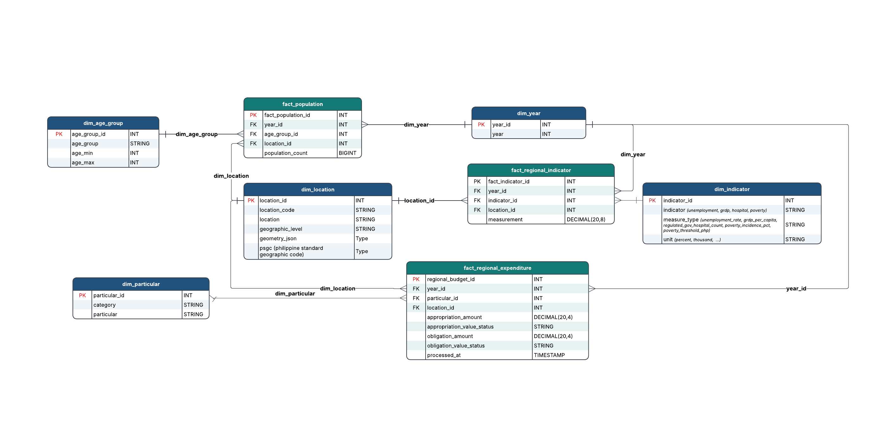

# PondoLens Data Model

PondoLens transforms raw Philippine government budget, population and development data into structured datasets for analyzing government budget and spending. The model supports reporting on where funds are appropriated, how appropriations compare with obligations, and how regional budgets relate to population and economic conditions.

The reporting scope covers **2021–2025**. Data passes through Bronze for raw ingestion, Silver for cleaning and standardization, and Gold for analysis. This document describes the Gold data model.

## Model Design

PondoLens uses a **fact constellation schema**, where multiple fact tables share common dimension tables. 

**Fact tables** contain numerical values, such as budget amounts, population counts and indicator measurements. **Dimension tables** describe those values by year, location, budget particular, age group or indicator.

The model contains three fact tables and five dimension tables under `pondolens.dev_gold`.

| Table type | Tables |
|---|---|
| Facts | `fact_regional_expenditure`, `fact_population`, `fact_regional_indicator` |
| Dimensions | `dim_year`, `dim_location`, `dim_particular`, `dim_age_group`, `dim_indicator` |

## Model diagram

The image shows the relationships. Some labels and types in this export are older than the SQL, including `regional_budget_id`, the indicator measurement precision, and the geometry fields. Use the definitions below and the linked models for the current columns.

## Why we use this approach

Each fact answers a different question at a different level of detail:

- Budget records describe a **year, location, and budget particular**.
- Population records describe a **year, location, and age group**.
- Indicator records describe a **year, location, and indicator definition**.

Putting all of these into one table would repeat budget amounts for every age group and indicator. For example, joining one budget row to 18 age groups would repeat that amount 18 times. Separate facts keep those totals safe while shared dimensions let us compare the same year and location.

This is a **fact constellation**, made of related stars. Each fact connects directly to its dimensions. `dim_year` and `dim_location` are shared; the other dimensions describe only the facts that need them. A single star with one fact would require discarding detail or changing what one row means.

Appropriations and obligations stay together because they can share the same year, location, and particular. A full outer join keeps records that exist on only one side, with value statuses explaining missing amounts. Indicators use long form: `measurement` stores the value and `dim_indicator` identifies its meaning and unit.

## Dimension Tables

### `dim_year`

Provides the reporting year used by all three fact tables. Each year appears once. Fact tables reference `year_id`, while reports display the corresponding `year`.

| Column | Description |
|---|---|
| `year_id` — PK | Unique identifier for each year. |
| `year` | Calendar year used for filtering and reporting. |
| `processed_at` | Time the row was inserted. |

### `dim_location`

Provides the standardized geographic reference used across the model. Records with different source labels for the same location reference the same standardized location.

| Column | Description |
|---|---|
| `location_id` — PK | Unique identifier for each location. |
| `location_code` | Standardized location code. |
| `location` | Location name. |
| `geographic_level` | Classification used to distinguish regional, national and other allocation locations. |
| `geometry_json` | Geographic boundary information for map visualizations. |
| `psgc` | Source identifier labeled PSGC, retained as text. Its official code version is not independently verified. |
| `processed_at` | Time the row was inserted or last changed. |

### `dim_particular`

Describes the departments, agencies and other budget entries represented in the expenditure fact. The combination of `category` and `particular` identifies a distinct dimension record. Keeping both fields preserves the classification of each budget entry.

| Column | Description |
|---|---|
| `particular_id` — PK | Unique identifier for each category and particular combination. |
| `category` | Classification of the budget entry. |
| `particular` | Name of the department, agency or budget entry. |
| `processed_at` | Time the registry row was inserted. |

### `dim_age_group`

Defines the age groups used in population reporting.

| Column | Description |
|---|---|
| `age_group_id` — PK | Unique identifier for each age group. |
| `age_group` | Display label, such as `0–4` or `85 and over`. |
| `age_min` | Inclusive lower age limit. |
| `age_max` | Inclusive upper age limit; NULL for the open-ended oldest group. |
| `processed_at` | Time the row was inserted or last changed. |

### `dim_indicator`

Defines the regional indicators and explains how their measurements should be interpreted. This dimension gives meaning to the values stored in `fact_regional_indicator`.

| Column | Description |
|---|---|
| `indicator_id` — PK | Unique identifier for each indicator definition. |
| `indicator` | Indicator family, such as unemployment, GRDP per capita, health, poverty, education, or service access. |
| `measure_type` | Specific measure represented by the indicator. |
| `unit` | Unit of measurement, including its denominator or price basis. |
| `processed_at` | Time the row was inserted or last changed. |

## Fact Tables

The **grain** describes exactly what one row represents. Each fact table has a defined grain, and the corresponding combination of keys must be unique.

### `fact_regional_expenditure`

Stores government appropriations and obligations for budget analysis. Keeping both amounts at the same grain allows them to be compared for the same year, budget particular and location.

**Grain:** one row per year, particular and location.

**Unique combination:** `year_id`, `particular_id`, `location_id`.

| Column | Description |
|---|---|
| `regional_expenditure_id` — PK | Unique identifier for each expenditure record. |
| `year_id` — FK | References `dim_year`. |
| `particular_id` — FK | References `dim_particular`. |
| `location_id` — FK | References `dim_location`. |
| `appropriation_amount` | Budget allocation in Philippine pesos. |
| `appropriation_value_status` | Classification describing the appropriation value. |
| `obligation_amount` | Recorded financial commitments in Philippine pesos. |
| `obligation_value_status` | Classification describing the obligation value. |
| `processed_at` | Timestamp associated with processing the record. |

### `fact_population`

Stores population counts by year, location and age group. The population dataset uses Both sexes records. Regional population totals are calculated by summing the non-overlapping age groups for the selected year and location.

**Grain:** one row per year, location and age group.

**Unique combination:** `year_id`, `location_id`, `age_group_id`.

| Column | Description |
|---|---|
| `fact_population_id` — PK | Unique identifier for each population record. |
| `year_id` — FK | References `dim_year`. |
| `age_group_id` — FK | References `dim_age_group`. |
| `location_id` — FK | References `dim_location`. |
| `population_count` | Projected population measured in persons. |
| `processed_at` | Time the row was inserted or last changed. |

The source values are population projections and should be identified as projections in reports. Population counts must not be summed across years.

### `fact_regional_indicator`

Stores regional development measurements with one measurement per record. This structure allows different indicators to use the same fact table while retaining their definitions in `dim_indicator`.

**Grain:** one row per year, location and indicator.

**Unique combination:** `year_id`, `location_id`, `indicator_id`.

| Column | Description |
|---|---|
| `fact_indicator_id` — PK | Unique identifier for each indicator record. |
| `year_id` — FK | References `dim_year`. |
| `indicator_id` — FK | References `dim_indicator`. |
| `location_id` — FK | References `dim_location`. |
| `measurement` | Numerical value expressed in the indicator’s defined unit. |
| `value_status` | Status retained for interpreting available and missing measurements. |
| `source_table` | Silver table that supplied the measurement. |
| `processed_at` | Time the fact record was inserted or updated. |

## Table Relationships

**PK** means primary key: the unique identifier of a table record.

**FK** means foreign key: a reference to a record in another table.

Each dimension has a **one-to-many** relationship with its related facts. One dimension record can describe many fact records, while each fact record references one record in each required dimension.

| Dimension | Related fact table | Relationship key |
|---|---|---|
| `dim_year` | All three fact tables | `year_id` |
| `dim_location` | All three fact tables | `location_id` |
| `dim_particular` | `fact_regional_expenditure` | `particular_id` |
| `dim_age_group` | `fact_population` | `age_group_id` |
| `dim_indicator` | `fact_regional_indicator` | `indicator_id` |

For example, one location record can be referenced by multiple budget entries, population age groups and indicator measurements. The fact tables are compared through their shared year and location references.

## Key types and checks

| Table or field | Type in the current model |
|---|---|
| `dim_year.year_id`, `dim_age_group.age_group_id`, `dim_particular.particular_id`, `dim_indicator.indicator_id` | INT |
| `dim_location.location_id` | BIGINT |
| `fact_population.fact_population_id` | INT |
| `fact_regional_expenditure.regional_expenditure_id`, `fact_regional_indicator.fact_indicator_id` | BIGINT |
| `fact_population.population_count` | BIGINT |
| Expenditure amounts | DECIMAL(20,4) |
| Indicator `measurement` | DECIMAL(28,10) |
| `geometry_json`, `psgc`, descriptions, and statuses | STRING |
| `processed_at` | TIMESTAMP |

PK/FK labels describe the intended relationships. SQL assertions and dbt tests check unique keys, required values, and dimension matches; the diagram does not imply database-enforced foreign keys.

The current SQL uses BIGINT for `dim_location.location_id` and the population reference, but INT for the location references in the expenditure and indicator facts. Current IDs fit INT; aligning these types remains an implementation cleanup. This guide records the existing types rather than claiming they are already consistent.

## Combining the Fact Tables

The fact tables store data at different levels of detail. For regional comparisons, each dataset is prepared at the year-and-location level before joining to prevent repeated values and inflated totals.

| Fact table | Preparation | Result |
|---|---|---|
| `fact_regional_expenditure` | Appropriations and obligations are combined separately for each year and location. | One row per year and location |
| `fact_population` | Age group counts are added to get the total population for each year and location. | One row per year and location |
| `fact_regional_indicator` | One indicator is selected for each year and location. | One row per available year and location |

The prepared results are joined using `year_id` and `location_id`, with each dataset containing at most one row per key combination. Check geographic boundaries before interpreting a comparison. Matching location codes identify records, but do not prove that the sources use the same historical boundaries.

## Reporting Measures

The current presentation focuses on three analytical questions:

| Focus | Measure | Calculation |
|---|---|---|
| AP1 — Distribution | Department or regional allocation | Sum appropriation_amount at the selected grain |
| AP2 — Population | Obligations per resident | Regional obligations / same-year regional population |
| AP2 — Population | Obligations share and population share | Each region's value / total across the same matched region set × 100 |
| AP2 — Population | Share gap, percentage points | Obligations share − population share |
| AP3 — Economic context | GRDP per capita vs. obligations per resident | Constant-2018-price GRDP measure compared with current-peso obligations per resident within a selected year |

Aggregate each fact separately before joining by year and location. For regional comparisons, exclude Central Office and Nationwide. AP2/AP3 use region-year records with matching measures and positive population; their benchmark represents the matched regional set, not the full national government total.

Budget gap and obligation/appropriation ratios can be derived for compatible records but are supplementary calculations, not the current AP2 focus. Avoid division by zero and preserve source value statuses.

AP3 uses different price bases on its two axes. It describes within-year regional positioning, not a monetary ratio or proof of causation. The current scatter excludes NCR for readability; the base view retains it.

## Scope and interpretation limits

The capstone focuses on annual regional comparisons for **2021–2025**. The model supports more indicators than the three current analytical questions use. It does not claim complete coverage for every region, indicator, and year.

| Limit | How to use the results |
|---|---|
| Budget amounts describe allocations and commitments. | Do not describe obligations as cash paid, completed projects, or money received by residents. Project-level delivery and spending effectiveness are outside this model. |
| Population is projected, and sources use different regional coverage. | Use the same matched region set for both sides of a comparison. Do not invent NIR population from a code mapping. |
| NIR and other boundary changes affect historical comparisons. | Review dataset-specific mapping notes. A shared region key does not make all historical boundaries equivalent. |
| Some measurements are unavailable or have reliability markers. | Preserve NULLs and statuses. Check the Silver guide before ranking or interpreting a reported zero. |
| GRDP and budget amounts use different price bases in AP3. | Compare within-year patterns; do not treat the axes as a monetary ratio or an inflation-adjusted spending trend. |
| Not every source detail is carried into Gold. | Follow `source_table` to the Silver guide for release status, reliability, footnotes, and transformations. Gold is not a full source archive. |
| Original GeoJSON publisher, license, CRS, and effective date are not verified; the 2025 poverty reference period also needs confirmation. | Keep these source limitations visible. Map checks validate structure, not official boundary accuracy. |
| Dimensions describe current standardized definitions. | The model does not preserve a full history of dimension changes or link indicators to individual agency programs. |

Within the capstone timeline, the reporting focus is distribution, population context, and GRDP context. These results support further investigation; they do not prove unfair allocation, corruption, or a causal effect of spending on development.

## Related files

- [Data sources](data_sources.md)
- [Silver dataset guides](../README.md#silver-documentation)
- [Gold SQL models](../dbt/models/gold)
- [Gold models and tests](../dbt/models/gold/schema.yml)
- [Analytics setup](../analytics/readme.md)
- [AP2 definitions](analytics/AP2_population_vs_spending_gap.md)
- [AP3 definitions](analytics/AP3_grdp_vs_obligations_scatter.md)
- [Dashboard lineage](../dashboard/PondoLens_Dashboard.md)
