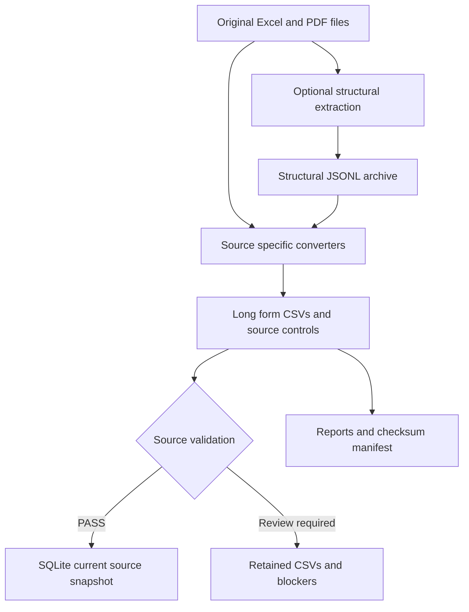
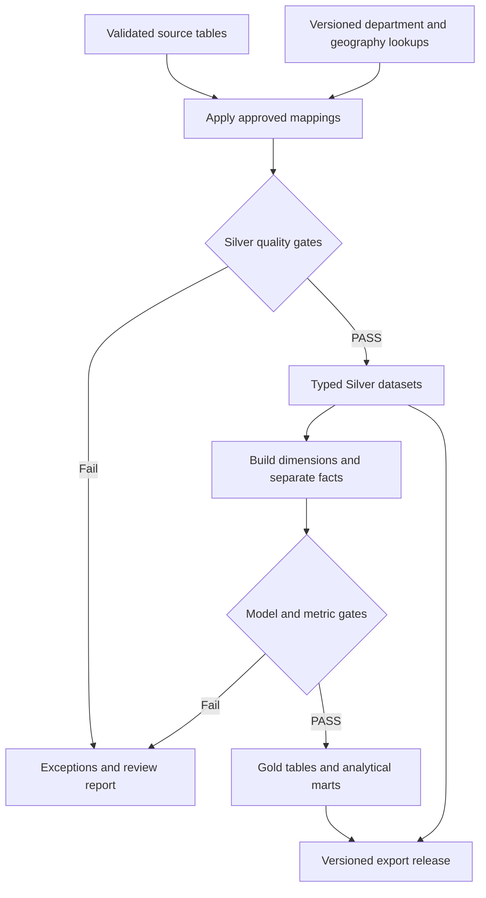
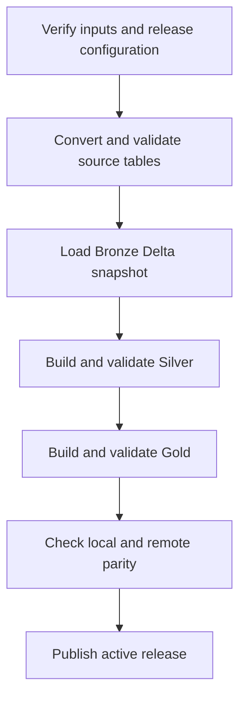

# Pipeline architecture and delivery plan

This document separates the executable local source pipeline from the proposed Silver, Gold and Databricks stages. Development remains local first. Databricks is the final execution and delivery environment after reviewed logic passes the same controls there.

## Current data flow



`pondolens` performs optional original preservation and structural extraction. `pondolens-long` reads originals directly or an existing structural archive and publishes validated source tables. The two input paths are alternatives, not two successive conversion requirements.

The preserved originals/structure serve the Bronze role. Current normalized source tables provide the starting point for Silver, but canonical identities, scope alignment and detailed hierarchy are not complete. Long format describes table shape, not completion of a medallion layer.

## Local Silver and Gold plan



### Silver transformations

Keep source datasets separate until their semantics support a join. Apply approved department identities while retaining original names/codes. Geography mapping must account for period-specific boundaries. Normalize financial amounts into a documented currency scale and keep obligations, disbursements, approved appropriations and cash-based expenditure as distinct measures.

Use explicit types: identifiers remain strings; monetary values use tested decimal precision/scale; population counts use integer domains; years use integer types; source state and eligibility fields remain available. Preserve source hash, record key and coordinates. Derived keys and mappings must have a versioned contract.

The local implementation can continue using Python and SQLite. A typed Parquet adapter using PyArrow is planned for interchange; package installation and a locked environment will be added when this adapter exists. No local Spark installation is currently necessary.

Before publishing Silver, require:

- Unique approved mapping keys; no conflicting canonical targets.
- One-to-one or many-to-one joins as designed; row counts must not increase unexpectedly.
- Unmatched rows retained with a review state and documented coverage, rather than silently dropped.
- Monetary totals unchanged by identity mapping at equivalent source scope.
- No detail/control/subtotal mixing; approved financial and geographic coverage for the requested comparison.
- Source counts, null/domain checks, schema checks and unchanged rerun checks passing.

Identity normalization and scope verification are separate gates. A department may be identified correctly while its funding coverage remains unsuitable for approved-versus-actual comparison.

### Proposed Gold model

The final dimensional model will be approved after business questions and comparable source grains are confirmed. The following is a candidate model, not implemented tables or a promise of a fixed dimension/fact count.

| Candidate table | Proposed grain | Metric restrictions |
|---|---|---|
| `dim_fiscal_year` | One fiscal year | Source series retain their original period semantics |
| `dim_department` | One approved department identity/version | Preserve year-specific aliases and documented reorganizations |
| `dim_region` | One region identity for a boundary version | Boundary version must participate in geographic comparisons |
| `dim_sector` | One source classification sector/version | No assumed department-to-sector equivalence |
| `fact_department_budget` | Year, department, approved fund scope | Aggregate only verified GAA lines at the chosen scope |
| `fact_department_actuals` | Year, department, funding scope and measure | Obligations/disbursements remain distinguishable |
| `fact_sector_expenditure` | Year, sector, reporting basis and status | Cash-based sector expenditure is a separate series |
| `fact_regional_expenditure` | Year, department/SPF, region boundary version | Exclude subtotal rows and treat unallocated geography explicitly |
| `regional_context` | Year, region boundary version, indicator and basis | Population and per-capita GRDP have distinct aggregation rules |

Additional fund, measure, price-basis or classification dimensions may be needed; review them before implementation. Never join raw fact tables directly on department name and then sum both measures. Aggregate compatible budget and actual facts to the same reviewed grain before comparison, and test the join cardinality.

Gold checks include fact-key uniqueness, dimension referential integrity, source-to-fact monetary reconciliation, ratio denominator checks, coverage disclosure and rerun stability. Percentages, indices and per-capita indicators are not summed. A utilization metric must state its numerator and denominator and be withheld where scope is incompatible.

## Local to Databricks migration

The official planned final run path is **land source files, execute versioned source conversion, load typed Bronze source tables, build Silver, build Gold, and validate the analytical outputs**. Local Gold exports are comparison evidence, not the only remote pipeline input. This allows the final environment to reproduce transformations rather than only display a precomputed result.

The current SQLite publisher must not be copied unchanged onto a Volume. Its filesystem locking and publication strategy target local storage. Extract the converter logic behind a Databricks adapter and write appropriate Delta tables; use local scratch for any transient single-process parser work and verify behavior on the selected compute.

### Files in Volumes and tables in schemas

Unity Catalog Volumes govern file storage with paths such as `/Volumes/<catalog>/<schema>/<volume>/...`. They can hold originals, mapping files, release exports and manifests. Files in a Volume must be read and written into separate table storage for SQL-managed tables; a SQLite file does not automatically become a set of Delta tables. See [Databricks Volume documentation](https://docs.databricks.com/aws/en/volumes/).

Proposed names, subject to workspace approval:

| Environment/object | Proposed name | Responsibility |
|---|---|---|
| Development catalog | `pondolens_dev` | Remote integration tests |
| Final catalog | `pondolens` | Approved release tables |
| Landing schema and Volume | `landing.source_files` | Versioned originals, mappings and releases |
| Layer schemas | `bronze`, `silver`, `gold` | Separate governed tables |
| Quality schema | `quality` | Run audit, source status, exceptions and reconciliation evidence |

Example future file paths:

```text
/Volumes/pondolens_dev/landing/source_files/originals/<source_sha256>/<filename>
/Volumes/pondolens_dev/landing/source_files/mappings/<mapping_version>/department.csv
/Volumes/pondolens_dev/landing/source_files/releases/<release_id>/manifest.json
```

These are design examples, not existing workspace resources. Catalog/schema/Volume names and paths must be configured per target. Managed Delta tables should use catalog/schema/table names, with their storage managed separately from the landing Volume.

### Transfer and execution sequence

1. Freeze the local release: source hashes, Git commit, dependency versions, schema version, approved mappings, expected counts and reconciliation controls.
2. Export typed Parquet with explicit schemas; preserve exact decimals and text identifiers. Include a transfer manifest with relative file paths, SHA-256 checksums and row counts. Exporting from SQLite requires explicit type conversion.
3. Provision Unity Catalog objects and the required use/read/write/create permissions. Select supported Unity Catalog compute and authenticated deployment access. Workspace-specific setup is not completed yet.
4. Upload originals, approved mapping files and release evidence to their versioned Volume paths using the UI or authenticated CLI. Verify hashes and counts after upload; transferring files alone does not execute ingestion.
5. Deploy code from a pinned Git version with environment-specific configuration. Reproduce source conversion, load the Bronze source snapshot as typed Delta tables and record provenance/status.
6. Run the reviewed Silver and Gold transformations with the same definitions and quality gates as local execution.
7. Compare local and Databricks results: source/table counts, business-key sets, exact financial totals, mapping coverage and deterministic value digests using identical serialization rules.
8. Rerun unchanged inputs; verify no duplicate growth or changed measures. Test revised-source replacement and recovery before publishing dashboard queries.

Do not upload only the SQLite file and claim migration is complete. Do not upload every historical structural generation merely because it exists. Only the selected release and required reproducibility evidence belong in the final transfer.

### Planned idempotency and publication

Current local conversion reuses a fingerprint only when inputs/configuration/code/dependencies and saved output checksums agree. SQLite publication is a transaction replacing the current source snapshot. This is proven local behavior; Databricks behavior still needs implementation and tests.

For Databricks, use a release ID and stage all layer outputs before changing the active release. Validate source uniqueness before any Delta merge; `MERGE` can be ambiguous when multiple source rows update one target row, and it does not remove duplicate records inside an incoming batch by itself. See [Delta merge semantics](https://docs.databricks.com/aws/en/delta/merge).

A revised source must replace its applicable current scope or create a new version with a controlled active-release pointer. An insert-only merge on keys containing source hashes would accumulate revisions and overstate totals. Multi-table publication is not a single SQLite-style transaction; keep the previous release active until all required tables and gates succeed.

### Planned job order and deployment



Only successful upstream tasks permit downstream publication. Record task status, source/release IDs, Git SHA, timestamps, counts, checks, errors and mapping versions. A failed quality gate must fail the job, preserve review evidence and keep the previously approved release available.

Use Databricks Jobs with versioned YAML deployment configuration. Databricks documentation currently calls deployment bundles **Declarative Automation Bundles**; they were previously called Databricks Asset Bundles. Bundles define resources/configuration and support CLI validation, deployment and execution. See [bundle documentation](https://docs.databricks.com/aws/en/dev-tools/bundles/).

Planned `databricks.yml` and `resources/pondolens_job.yml` will define separate development/final targets, parameters, task dependencies, compute, timeouts, retries and permissions. No runnable bundle exists in the current branch. Credentials belong in supported authentication/secret mechanisms. CD should be introduced only after remote integration and rerun evidence exists.

Current GitHub Actions runs local Python tests. Future CI can add schema/contract checks, approved mapping validation, bundle validation and a development integration job. A passing local pytest run does not certify Spark execution or workspace permissions.

## Delivery gates

| Phase | Required evidence before proceeding |
|---|---|
| Source review | Recorded comparisons and discrepancies for issues #2–#5 |
| Mapping approval | Reviewed department identity and funding coverage; geographic decisions where relevant |
| Local Silver | Explicit schema, mappings, non-expanding joins, reconciled totals and repeatable output |
| Local Gold | Agreed questions/model, key integrity, metric definitions and coverage tests |
| Databricks integration | Versioned release transfer, typed Delta tables, remote execution and parity checks |
| Final release | Rerun/revised-source/recovery tests, approved release publication and validated dashboard metrics |

The next dependency is human source and mapping review. Engineers can develop the configuration, typed export and test contracts in parallel with review, but must not publish cross-source comparisons as verified before the required identity, scope and geography decisions are complete.
